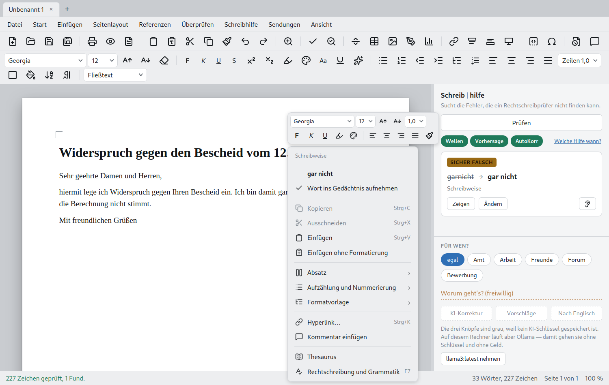

# Die Oberfläche

Band und Symbolleisten, das Lineal, Formatvorlagen, Anpassen.

**Zwei Oberflächen.** *Ansicht ▸ Benutzeroberfläche* stellt zwischen
Symbolleisten (zwei Zeilen, alles sichtbar) und Registern (Reiter wie in
Word) um. Dieselben Befehle, anders sortiert.

Das Register hat neun Reiter — Datei, Start, Einfügen, Seitenlayout,
Verweise, Überprüfen, Schreibhilfe, Ansicht, Abschnitt (*Sendungen* lässt sich über
*Register anpassen* dazuholen) — und vier weitere, die nur da sind, wenn sie
etwas zu sagen haben: Tabellentools, Bildtools, Form- und WordArt-Tools sowie
Kopf- und Fußzeilentools.

**Der Reiter Datei ist eine Backstage-Ansicht**, wie bei ONLYOFFICE: Ein Klick darauf ersetzt das
Dokument durch zwei Spalten — links die Befehle (Neues Dokument, Von Vorlage, Öffnen, Zuletzt benutzte,
Speichern, Speichern als, Drucken, Schützen, Info, Öffnen mit …, Schließen, Erweiterte Einstellungen, Hilfe),
rechts die Seite dazu. Zurück geht es mit **Esc**, *Zurück zum Dokument* oder einem anderen Reiter.

Links davor steht weiterhin **☰ Menü**: Neu, Öffnen, Speichern, Speichern unter, Als PDF
exportieren, Als Bild exportieren, Drucken, Dokumentverschlüsselung,
Hilfe, Optionen, Beenden. Es klappt als Tafel mit zwei Spalten auf —
links die Befehle, rechts die zuletzt benutzten Dateien. Ein Punkt mit
Pfeil legt kein Fenster darüber, er füllt die rechte Spalte.

**Der Reiter Abschnitt** ist wie bei WPS aufgebaut und kennt jetzt **mehrere Abschnitte**: hinzufügen (nächste Seite, fortlaufend,
gerade, ungerade), löschen, vorheriger/nächster, Navigation (Strg+G ▸ Abschnitt) und *Abschnitt einrichten …*. Orientierung, Größe, Ränder,
Spalten und Kopf-/Fußzeile gelten für den Abschnitt, in dem die Schreibmarke steht; die Kopf-/Fußzeile lässt sich mit dem Vorgänger
verknüpfen. Seitenansicht, Druck, PDF und DOCX setzen jeden Abschnitt in seinen eigenen Maßen. *Gerade und ungerade Seiten
unterschiedlich* steht weiter ausgegraut da (Hinweis im Tooltip). **Grenzen:** Die Bearbeitungsansicht zeigt alle Abschnitte in der
Seitengeometrie des ersten (ein Qt-Dokument hat nur eine Seitengröße), ein fortlaufender Umbruch mit anderer Spaltenzahl beginnt in
der Ausgabe auf einer neuen Seite, und Fuß-/Endnoten werden je Abschnitt neu nummeriert.

Gleich daneben der **Schnellzugriff**: Öffnen, Speichern, Als PDF,
Drucken, Druckvorschau, Rückgängig, Wiederholen. Dasselbe ☰ steht auch
am Anfang der oberen Symbolleiste — beide Oberflächen tragen denselben
Aufbau.

**Die beiden Lineale** messen wirklich: Zentimeter mit Zahlen, vom
Satzspiegel aus gezählt wie im Writer, und drei Marken für die Einzüge,
die sich ziehen lassen — erste Zeile, links, rechts. Das helle Band zeigt,
wo Text steht, und wandert beim Ziehen mit. Das **senkrechte** misst von
der ersten Zeile abwärts und scrollt mit dem Blatt; es lässt sich einzeln
ein- und ausschalten, so wie WPS es hält.

**Die drei Marken.** Im Kopf der Schreibhilfe, neben *Prüfen*, stehen **We**, **Vo** und **Ko** —
Wellen, Vorhersage, AutoKorrektur. Grün heißt an, ein Klick schaltet. Sie lagen
vorher in *Extras ▸ Beim Schreiben*, wo sie niemand fand.

**Die rechte Maustaste.** Zwei Kästen, wie im WPS Writer: oben eine
schwebende Formatleiste — Schriftart, Größe, fett, kursiv, Farbe, Marker,
Ausrichtung, Pinsel —, darunter ein kurzes Menü mit Bild links und
Tastenkombination rechts.

Es zeigt nur, was an dieser Stelle etwas bewirkt: auf einem Hyperlink
bearbeiten und entfernen, in einer Tabelle Zeilen und Spalten, auf einem
Bild Größe und Umbruch. Was gerade nicht geht, steht **grau** da statt zu
fehlen — ein Punkt, der mal da ist und mal nicht, lässt sich nicht lernen.

Auf einem Wort sieht das Programm auch dann nach, wenn noch gar nicht
geprüft wurde: Wer auf *garnicht* klickt, bekommt *gar nicht* — nicht eine
Liste ähnlich klingender Wörter.

**Tabellenwerkzeuge** erscheinen, sobald der Zeiger in einer Tabelle steht,
und verschwinden wieder; dazu Bildtools, Form- und WordArt-Tools und Kopf- und
Fußzeilenwerkzeuge und SmartArt-Tools. Zeichen-, Diagramm- und Gleichungswerkzeuge gibt es noch
nicht (siehe [PRUEFBOGEN.md](PRUEFBOGEN.md)). Die Gruppen folgen
dem Menüband von WPS: *Start* trägt Zwischenablage, Schriftart mit Name und Größe in einer Zeile,
Absatz, Formatvorlagen, Wort-Extras, Suchen oder ersetzen, Auswählen und Einstellungen. Was es nativ
noch nicht gibt, steht ausgegraut da statt zu fehlen.

Auf *Start* steht der **Formatvorlagen-Katalog**: Er zeigt die Vorlage, statt sie zu benennen —
sechs Kacheln in zwei Zeilen. Der Pfeil daneben klappt sie groß auf — an
derselben Stelle, so dass das Menü die Gruppe verdeckt und nichts doppelt
dasteht. Darin alle Vorlagen samt den eigenen, dazu *Neue Formatvorlage*,
*löschen* und *verwalten*.

**Eigene Formatvorlagen.** Was fehlt, legt man selbst an: eine
*Anschrift*, die immer rechts steht, ein *Merksatz* in Grau. Der Dialog
fragt nach Name und worauf sie aufbaut; die Formatierung steht darunter in
zwei Leisten — oben die Schrift, darunter der Absatz — und ganz unten eine
Vorschau, die sich beim Tippen mitändert. Wer „baut auf" umstellt, sieht
die übrigen Felder mitgehen. Eigene Vorlagen gehören zum Dokument und
wandern mit dem Reiter. *Hinweis zum Stand:* Vorhandene Vorlagen lassen sich verwalten und ändern; das Anlegen
und Löschen eigener Vorlagen ist in der Qt-Fassung noch offen.

Wo eine Gruppe nicht alles zeigt, was es gibt, steht unten rechts ein

**Pfeil ⭨** zum vollen Dialog. Ein **Doppelklick auf den Reiter** klappt
das Band weg und wieder auf.

Im Register **tritt die Reiterzeile an die Stelle der Menüleiste** — sie
kommt nicht dazu. Beides übereinander fräße genau den Platz, den das
Register gewinnen soll. Das Menü bleibt über das Zeichen ☰ links in der
Reiterzeile erreichbar. In der Symbolleisten-Ansicht lässt sich
die Menüleiste ebenfalls ausblenden. Symbolgröße und die Schrift der
Bedienung sind einstellbar — wer die Leisten nicht lesen kann, benutzt sie
nicht.

**Das Register anpassen.** Rechtsklick auf eine freie Stelle im Band, oder
*Ansicht ▸ Oberfläche ▸ Anpassen*: Die Gruppen eines Reiters lassen sich
umsortieren und einzeln ausblenden. Verschoben wird mit zwei Pfeilen und
nicht mit der Maus — Ziehen und Ablegen verlangt eine ruhige Hand, ein
Pfeil nach oben trifft immer. Ausgeblendetes bleibt blass in der Liste
stehen, damit man es zurückholen kann.

**Ein Symbol austauschen.** Rechtsklick auf einen Knopf — im Band wie in
den Symbolleisten. Ein Fenster zeigt, wo die Zeichnung überall benutzt
wird, dazu ein Suchfeld und **1801 Zeichnungen** zur Wahl. Ein Klick, und
sie ist getauscht; „Zurücksetzen" holt die alte zurück. LibreOffice kann
das für seine Symbolleisten, für sein Symbolband nicht — hier geht beides. Ein getauschtes Symbol
erscheint in der Strichzeichnung der Auswahl statt im Fluent-Stil der übrigen.

---

[← Zurück zum README](../README.md)
